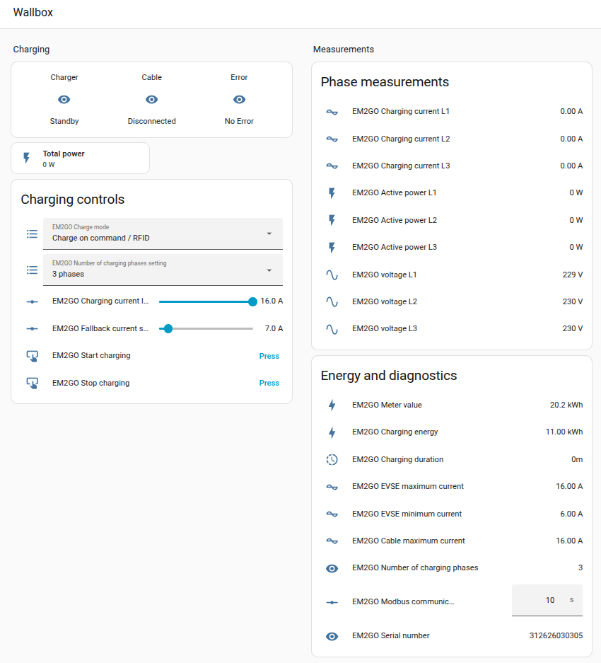

# EM2GO Home Wallbox Modbus for Home Assistant

Home Assistant YAML configuration for monitoring and controlling an EM2GO Home series wallbox over Modbus TCP.

The configuration is based on the EM2GO Home series Modbus TCP register guide. It includes read-only measurements and template controls for the documented writable registers.

## Sources and attribution

The initial Home Assistant Modbus configuration and register-reading example were shared by Henrik Palin (`HgoP`) in the [Home Assistant Community thread](https://community.home-assistant.io/t/em2go-ac-wallbox-home-ev-charger-in-home-assistant/868686). In a follow-up, HgoP reported that native Modbus switches worked after changing their `write_type` from `holding` to `holdings` (function code 16).

This package is an adaptation: it updates and extends that example with template entities, write controls, serial-number formatting, and device-specific scaling notes. It is not endorsed by HgoP, EM2GO, or Home Assistant. The register definitions are also based on the [EM2GO Home Modbus register guide](https://wallboxcenter.de/wp-content/uploads/2024/06/EM2GO-Home-Wallbox-11kw-Modbus-Register.pdf).

## Features

- Charger, cable, and error status sensors
- Total and per-phase power, current, voltage, energy, and duration sensors
- Wallbox and cable current limits
- Serial number displayed as the three register words formatted as 12 hexadecimal characters
- Template number controls for fallback current, Modbus timeout, and charging current limit
- Template selects for charge mode and phase count
- Start and stop buttons for charging: work only in command/RFID charge mode

## Dashboard

`dashboard.yaml` is a standalone Lovelace dashboard for the entities in `modbus_em2go.yaml`. Copy it to your Home Assistant config directory as `dashboard-em2go.yaml`, then add this entry under the existing top-level `lovelace:` key in `configuration.yaml`:

```yaml
lovelace:
   dashboards:
      em2go-wallbox:
         mode: yaml
         filename: dashboard-em2go.yaml
         title: EM2GO Wallbox
         icon: mdi:ev-station
         show_in_sidebar: true
```

If `lovelace:` already contains `resources:` or `dashboards:`, merge this entry into those existing mappings; do not add a duplicate `lovelace:` key. The dashboard uses built-in Lovelace cards only. Restart Home Assistant after changing the configuration.

### Screenshot of the Dashboard




## Requirements

- Home Assistant with the built-in Modbus and Template integrations
- An EM2GO Home series wallbox with Modbus TCP enabled
- Network connectivity from Home Assistant to the wallbox on TCP port 502

The device address (Unit ID) is set to `255`, as required by the EM2GO register guide.

## Tested hardware and firmware

- Wallbox: EM2GO model Home a.k.a. `EMH011AC1RW`
- Hardware version: E22_1.3
- Software version: E3C_1.7

**App current ceiling:** On my EMH011AC1RW wallbox, setting the wallbox maximum current to `6 A` through the Smartphone App (EM2Go Home) before enabling load management and Modbus on the Wallbox kept charging limited to `6 A`, even when a higher current was requested through Home Assistant / Modbus. After raising the maximum to `16 A` in the app, Modbus control could charge at `16 A` or lower settings. Set the app-side maximum to the desired upper limit before switching to load-management/Modbus mode; the Modbus current limit cannot exceed that app-configured ceiling. This is an observed behavior on one unit, not confirmed across firmware versions.

## Installation

1. Copy `modbus_em2go.yaml` into your Home Assistant `config/packages/` directory, for example as `em2go_wallbox.yaml`.
2. Add the wallbox address to `secrets.yaml`:

   ```yaml
   em2go_wallbox_host: 192.168.1.50
   ```

   Replace the example address with the wallbox's reserved or static IP address.
3. If packages are not already enabled, add this to `configuration.yaml`:

   ```yaml
   homeassistant:
     packages: !include_dir_named packages
   ```

   If `homeassistant:` already exists, add `packages:` under that existing section instead of creating a second key. If packages are already enabled, no configuration change is needed.
4. Check the Home Assistant configuration, then restart Home Assistant.

The file contains top-level `modbus:` and `template:` sections and is intended to be loaded as a package. If integrating it manually into existing YAML, merge those sections into the corresponding existing sections instead of including the file as a sensor-only configuration.

## Register and implementation notes

- The guide specifies function code 03 for reading and function code 16 for writing. The template controls pass register values as one-item lists to `modbus.write_register`, requesting function code 16.
- Current values at addresses `87` and `91` are represented in amperes in Home Assistant and converted to/from the register's documented `0.1 A` units.
- Per-phase active power at addresses `16`, `20`, and `24` has `scale: 10`. This is an empirical correction based on observed readings from one wallbox: raw readings near `133` were seen while total power was about `4000 W`. Verify this scale with your own unit; the documentation example lists values in watts and may not describe every firmware/device behavior.
- The serial number registers at addresses `38` to `40` are exposed individually and combined into a 12-character hexadecimal string. The guide calls this a string, but observed values did not appear to be printable ASCII. Treat the hex display as a representation of the register words, not as a confirmed manufacturer serial-number encoding.
- The charge command at address `95` is only sent when charge mode at address `93` is `1`, in line with the guide.
- The number controls derive current limits from the wallbox and cable maximum/minimum sensors. Confirm these values and limits on your device before using the controls.

## Safety and network security

Modbus TCP does not provide authentication or encryption. Keep the wallbox on a trusted network and do not expose TCP port 502 directly to the internet. The controls can write settings and issue charging start/stop commands; review the register mapping and test carefully before relying on automations.

## License

The `modbus_em2go.yaml` configuration, `dashboard.yaml`, and this README are shared under the [Creative Commons Attribution-NonCommercial-ShareAlike 3.0 Unported License](https://creativecommons.org/licenses/by-nc-sa/3.0/). The configuration adapts HgoP's forum contribution, which is covered by the Home Assistant Community user-content license. Attribution and a description of changes are provided above. This license does not apply to the EM2GO name or trademarks, or to the manufacturer's register guide; those remain subject to their respective rights and terms.
